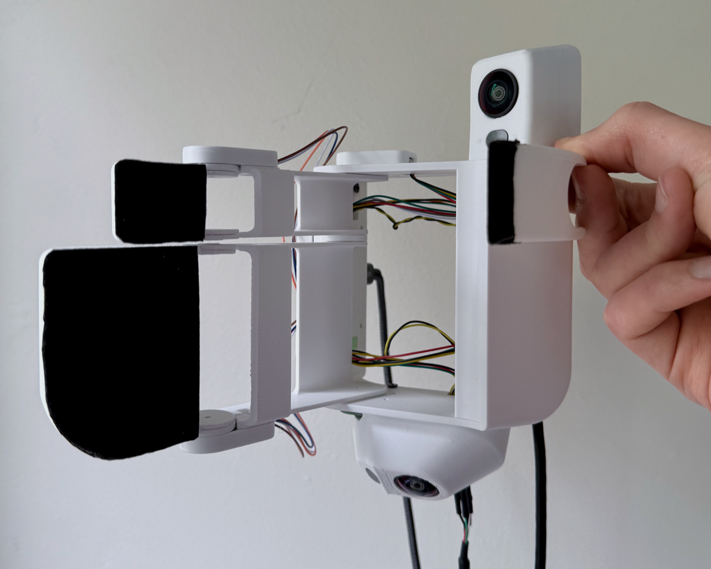
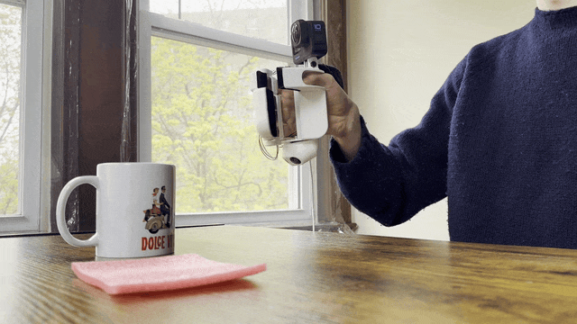
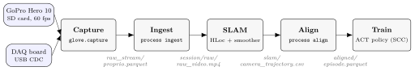
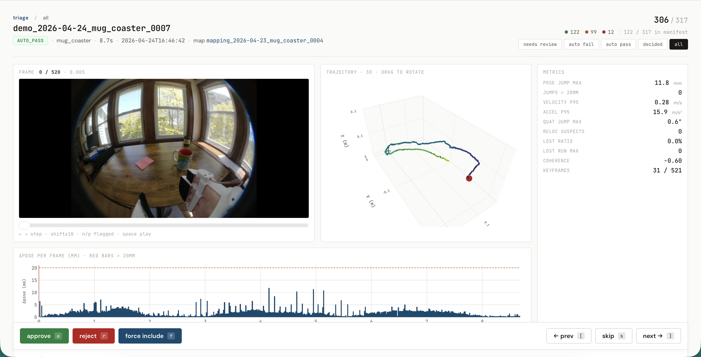
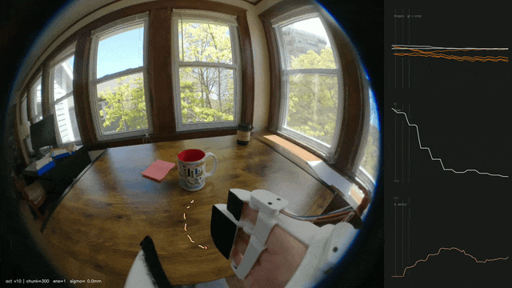

# Skill-Capture Glove

*A worn skill-capture system — end-to-end hardware, SLAM, and policy. Solo, four months.*

<p align="center">
  
</p>

An independent reimplementation of [Sunday Robotics'](https://sunday.ai/) Skill Capture Glove form factor, built solo from January through April 2026 as the final project for ME740 (Vision, Robotics, and Planning, Boston University). The hardware shown above is the V3 build with on-glove OV9782 stereo cameras; the production pose pipeline uses an externally-mounted GoPro Hero 10 plus [UMI's](https://umi-gripper.github.io/) monocular SLAM stack with [Hierarchical-Localization](https://github.com/cvg/Hierarchical-Localization) replacing ORB-SLAM3.

The repository contains every layer of the system: PCB design, firmware, capture pipeline, SLAM, alignment, and an ACT policy trained on 182 mug-on-coaster demonstrations.

<p align="center">
  
</p>

<p align="center"><i>One demonstration: pick the mug, place it on the coaster (~15 s).</i></p>

---

## What's in here

| Layer | What it does | Where |
|---|---|---|
| **Hardware** | Custom DAQ PCB (KiCad), four MLX90393 Hall sensor PCBs, V3 glove CAD | [`hardware/`](hardware/) |
| **Firmware** | STM32G431 — bit-bang I²C, USB CDC, sensor scheduling | [`firmware/stm32_daq/`](firmware/stm32_daq/) |
| **Capture** | Master-tape recorder + GoPro offload + per-demo ingest | [`software/glove/capture/`](software/), [`software/glove/process/`](software/) |
| **SLAM** | HLoc (SuperPoint + LightGlue + NetVLAD + COLMAP) + pose-graph smoother + Gaussian σ=5 | [`software/glove/process/hloc/`](software/) |
| **Align** | Trajectory + proprioception → training-ready `episode.parquet` | [`software/glove/process/align.py`](software/) |
| **Policy** | ACT (Zhao et al. 2023) — DINOv2 frozen backbone, 23-D obs, 21-D action | [`software/glove/policy/`](software/) |
| **Review dashboard** | Browse-only FastAPI UI for triaging captured demos against quality metrics | [`software/glove/dashboard/`](software/glove/dashboard/) |
| **Paper** | ME740 final report | [`paper/me740_report.pdf`](paper/me740_report.pdf) |

---

## Pipeline

<p align="center">
  
</p>

Five command-line stages, each operating on session directories with a stable schema:

```bash
python -m glove.capture record                     # continuous DAQ writer
python -m glove.capture offload                    # SD card → disk
python -m glove.process ingest --mp4 <file> ...    # MP4 + master tape → session dir
python -m glove.process build-model <map-session>  # SfM + HLoc map (run once per workspace)
python -m glove.process detect-aruco <map>         # tag detection
python -m glove.process calibrate-tag <map>        # gravity-align world frame
python -m glove.process localize <demo> --map <m>  # per-frame pose against the map
python -m glove.process align <demo>               # → episode.parquet
python -m glove.dashboard --data-dir data/sessions # browse + review demos at localhost:8000
```

See [`docs/reproduce.md`](docs/reproduce.md) for end-to-end reproduction commands. The full system architecture is documented in §3 of the [paper](paper/me740_report.pdf).

---

## Review dashboard

<p align="center">
  
</p>

A FastAPI browse-only UI for triaging captured demonstrations. Surfaces per-demo trajectory-quality metrics (local-straightness, high-frequency RMS, pose-jump max) on a scrubbable timeline alongside the GoPro video. This is the tool that caught 23% of the unfiltered demonstration set as silent SLAM pose-graph re-anchoring artifacts during the label audit.

---

## Headline results

- **SLAM proven against ground truth.** A controlled validation against a Kalibr 6×6 AprilGrid places the production HLoc + σ=5 stack within **0.2 mm** of the absolute camera + PnP physical noise floor on static no-cup frames (HLoc 8.3 mm p95 vs. AprilGrid 8.1 mm p95). Further improvement bounded to capture-side hardware.
- **Per-joint Hall force sensing.** A controlled scale-press experiment recovers **+1.29 counts/g (R² = 0.64)** on the compliant 3F PIP joint — force enters the policy as a designed-in byproduct of the PIP-slit axial compliance, not via a calibrated load cell.
- **ACT policy on 182 demonstrations.** The production checkpoint reaches **28.8 mm position L1, 6.31° rotation L1, and 736 LSB Hall L1** on a held-out validation set against the HLoc + σ=5 ground truth — roughly 3.5× the truth-source's own measurement floor. A label-quality audit — driven by the [browse-only review dashboard](software/glove/dashboard/) shipped alongside the pipeline — excluded 23% of the unfiltered demonstration set as silent SLAM pose-graph re-anchoring artifacts before retraining.

  <p align="center">
    
  </p>

  <p align="center"><i>Production policy predicting the next action chunk on a held-out demonstration. Predicted Hall traces (right panel) track the squeeze cycle through the grasp event.</i></p>

- **Eight-backend SLAM pivot chain.** DROID → COLMAP → custom stereo SIFT → OKVIS2 → custom GTSAM v1/v2/v3 → ORB-SLAM3 → HLoc + smoother. Each fork accepted what the evidence said rather than tuning a stack already at its diagnosed limit. Full chain documented in Sec. 5 of the paper.

---

## Built with

- [UMI](https://umi-gripper.github.io/) — Cheng Chi et al. 2024. Source of the Hero 10 + ORB-SLAM3 + Docker stack the production pipeline forked from.
- [Hierarchical-Localization (HLoc)](https://github.com/cvg/Hierarchical-Localization) — Sarlin et al. 2019. Production SLAM stack.
- [SuperPoint](https://github.com/magicleap/SuperPointPretrainedNetwork), [LightGlue](https://github.com/cvg/LightGlue), [NetVLAD](https://github.com/Relja/netvlad), [COLMAP](https://github.com/colmap/colmap)
- [ACT](https://github.com/tonyzhaozh/act) — Zhao et al. 2023. Policy architecture.
- [DINOv2](https://github.com/facebookresearch/dinov2) — frozen ViT-S/14 visual backbone.
- [GoPro Labs UTC precision-time QR](https://gopro.github.io/labs/control/precisiontime_utc/) — for ms-accurate camera-to-DAQ time sync.

---

## Hardware overview

- **Glove V3.** Two finger assemblies (single index + three-finger), four PIP and four MCP joints with 3 × 2 mm diametric magnets, fingertip caps, PIP axial-slit compliance.
- **DAQ PCB.** STM32G431 + TCA9548A I²C mux + QMI8658C IMU + 4 × MLX90393 Hall + 2 × VL53L1X ToF + USB CDC. Four-layer PCB, KiCad, manufactured by JLCPCB.
- **Cameras.** OV9782 stereo (on-glove, V3 build) + GoPro Hero 10 + MaxLens Mod 1.0 (155° fisheye, externally mounted, used for production SLAM).

The on-glove OV9782 stereo cameras shown in the hero image were the original SLAM sensors. The current pose pipeline uses the externally-mounted GoPro because OV9782 stereo VIO did not converge on the assembled glove (finger occlusion + USB bandwidth). Whether the HLoc stack would close the loop on the OV9782 cameras given a V4 USB and lens revision is an open question.

---

## Paper

**[A Worn Skill-Capture System: End-to-End Hardware, SLAM, and Policy](paper/me740_report.pdf)**
Cornelius Gruss · ME740 (Vision, Robotics, and Planning) · Boston University · 2026

---

## License

[MIT](LICENSE) — use, modify, and redistribute freely.

## Acknowledgments

Form factor inspired by [Sunday Robotics'](https://sunday.ai/) Skill Capture Glove. SLAM pipeline forked from [UMI](https://umi-gripper.github.io/). Policy architecture adapted from [ALOHA / ACT](https://github.com/tonyzhaozh/act). Built as the final project for ME740 (Spring 2026, Boston University) under Prof. John Baillieul.
